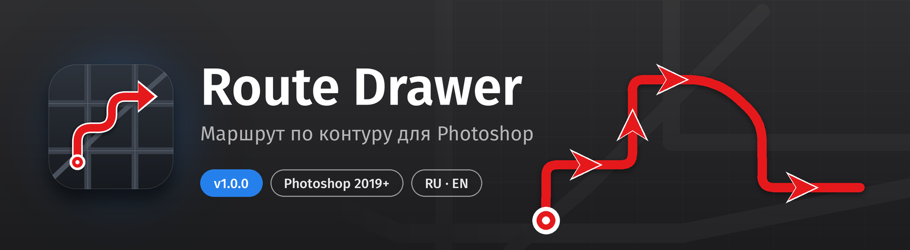
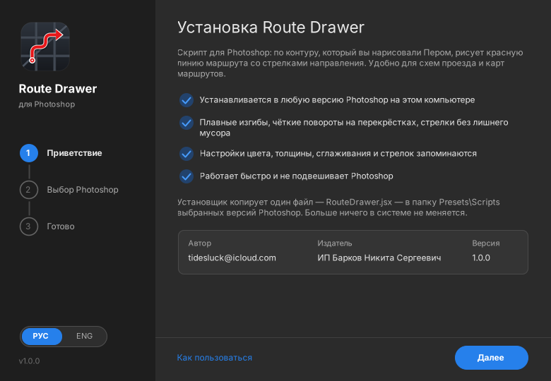
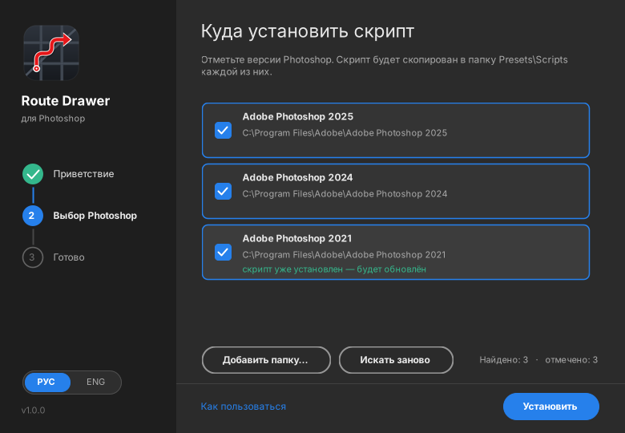
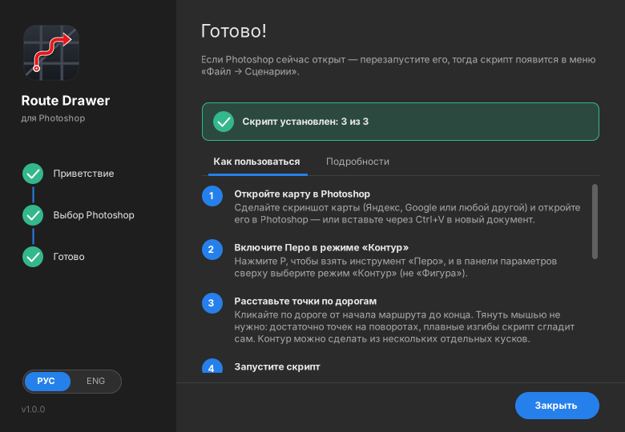
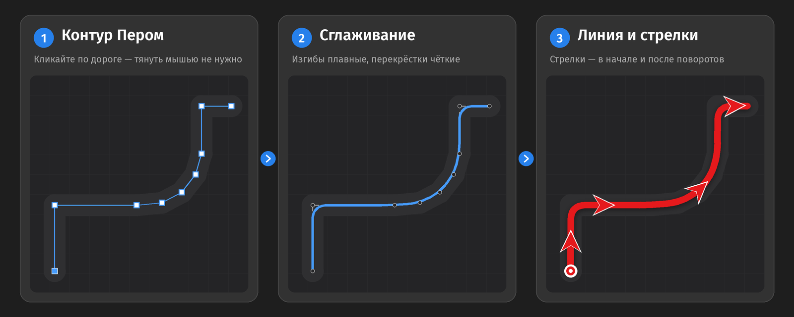
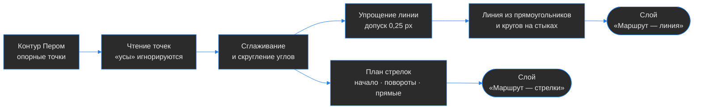

<div align="center">



<br>

**Ставите точки Пером по дорогам — скрипт рисует красную линию маршрута со стрелками направления.**

<br>


[](https://t1desluck.github.io/RouteDrawer/)

[Сайт](https://t1desluck.github.io/RouteDrawer/) · [Скачать](#скачать) · [Установка](#установка) · [Как пользоваться](#как-пользоваться) · [Настройки](#настройки) · [Как это работает](#как-это-работает) · [Частые вопросы](#частые-вопросы) · [Лицензия](#лицензия)

</div>

<br>

## Что это

**Route Drawer** — скрипт для Photoshop, который превращает контур, поставленный инструментом «Перо», в аккуратную красную линию маршрута со стрелками направления. Сделан для схем проезда и карт маршрутов, например учебных маршрутов автошколы: скриншот карты → несколько кликов по дорогам → один запуск скрипта.

| | |
|:--|:--|
| 🧭 **Одна непрерывная линия** | От первой до последней точки, без разрывов. Контур может состоять из нескольких отдельных кусков — каждый получит свои стрелки. |
| 🌊 **Умное сглаживание** | Плавные изгибы получаются гладкими, а резкие повороты на перекрёстках остаются чёткими (чуть скруглёнными). Тянуть «усы» у точек не нужно. |
| ➤ **Стрелки без мусора** | В начале маршрута, после поворотов и изредка на длинных прямых. Белая обводка, чтобы стрелки не терялись на красной линии. |
| ⚙️ **Гибкие настройки** | Цвет, толщина, сглаживание, размер и частота стрелок — в окне перед запуском. Настройки запоминаются. |
| ⚡ **Быстро и аккуратно** | Без кисти и «мазков»: геометрия считается в памяти и заливается порциями. Результат — два слоя, исходный контур не меняется, отмена одним `Ctrl+Z`. |
| 📦 **Готовый установщик** | Сам находит Photoshop и ставит скрипт в нужные версии. Русский и английский язык — по языку Windows. |

<br>

## Скачать

| Файл | Для чего | Размер |
|:--|:--|--:|
| [**RouteDrawer-Setup.exe**](https://github.com/T1desLuck/RouteDrawer/raw/main/RouteDrawer-Setup.exe) | Установщик для Windows — **рекомендуется** | 223 КБ |
| [RouteDrawer.jsx](https://github.com/T1desLuck/RouteDrawer/raw/main/RouteDrawer.jsx) | Только скрипт: ручная установка, macOS | 31 КБ |

<details>
<summary><b>Проверить файлы по контрольной сумме (SHA-256)</b></summary>

<br>

| Файл | SHA-256 |
|:--|:--|
| `RouteDrawer-Setup.exe` | `81fc8bab5091ff2cf153c149daefad1045d97de12463f7417b768d6ebfcffe49` |
| `RouteDrawer.jsx` | `206a2d154a569248057e397a4633988a8a1c39fe1cb08ece3d1ecc88b7c0b4d7` |

В Windows сумму можно посмотреть в PowerShell:

```powershell
Get-FileHash .\RouteDrawer-Setup.exe -Algorithm SHA256
```

Если сумма совпала с таблицей, файл скачан без изменений.

</details>

**Требования**

- Photoshop 2019 или новее. Скрипт использует только базовые возможности ExtendScript, поэтому на более старых версиях он тоже может работать, но это не проверялось.
- Установщик: Windows 10 / 11 (нужен .NET Framework 4.x — он входит в состав этих систем).
- macOS: скрипт можно скопировать вручную (см. ниже), но на Mac он не проверялся. Установщик — только для Windows.

<br>

## Установка

### Способ 1 — установщик (рекомендуется)

<p align="center">
  
  
  
</p>

1. Скачайте и запустите `RouteDrawer-Setup.exe`. Windows спросит разрешение администратора — оно нужно, чтобы записать файл в папку Photoshop в `Program Files`.
2. Нажмите **«Далее»**. Установщик сам найдёт установленные версии Photoshop: по реестру, в папках `Adobe` внутри `Program Files` на всех дисках, на рабочем столе, в загрузках и документах, а также в корнях дисков (например, `D:\Soft\Photoshop`). Если вашей версии нет в списке — нажмите **«Добавить папку…»** и укажите папку, где лежит `Photoshop.exe` (подойдёт и сама папка `Presets` или `Scripts`). Кнопка **«Искать заново»** повторяет поиск.
3. Отметьте нужные версии и нажмите **«Установить»**. Если скрипт там уже есть, он будет обновлён.
4. На последней странице — результат по каждой версии, кнопка **«Открыть папку Scripts»** и инструкция («Как пользоваться»), которую можно прочитать прямо в установщике.
5. **Перезапустите Photoshop** — скрипт появится в меню `Файл → Сценарии`.

> [!NOTE]
> Установщик пока не имеет цифровой подписи, поэтому Windows может показать предупреждение «Неизвестный издатель» или SmartScreen. Это ожидаемо. Убедиться, что файл не изменён, можно по [контрольной сумме](#скачать).

**Что делает установщик — и чего не делает**

- Копирует **один файл** — `RouteDrawer.jsx` — в папку `Presets\Scripts` выбранных версий Photoshop и сверяет записанный файл с оригиналом.
- Не пишет ничего в реестр и не оставляет служебных файлов. Деинсталлятора нет — он не нужен.
- Язык (русский или английский) выбирается по языку Windows (русский, украинский, белорусский, казахский и киргизский — русский интерфейс, остальные — английский); переключатель — слева внизу окна.
- Для записи в `Program Files` установщику нужны права администратора, поэтому он сам запрашивает их при запуске.

### Способ 2 — вручную

1. Скопируйте `RouteDrawer.jsx` в папку `Presets\Scripts` нужной версии Photoshop:

   | Система | Путь (пример) |
   |:--|:--|
   | Windows | `C:\Program Files\Adobe\Adobe Photoshop 2025\Presets\Scripts` |
   | macOS *(не проверялось)* | `/Applications/Adobe Photoshop 2025/Presets/Scripts` |

2. Перезапустите Photoshop — скрипт появится в меню `Файл → Сценарии`.

Установка не обязательна: скрипт можно запустить и прямо из любого места командой `Файл → Сценарии → Обзор…`.

### Удаление

Удалите файл `RouteDrawer.jsx` из папки `Presets\Scripts`. Больше ничего убирать не нужно.

<br>

## Как пользоваться

**1. Откройте карту в Photoshop.**
Сделайте скриншот карты (Яндекс, Google или любой другой) и откройте его в Photoshop — или вставьте через `Ctrl+V` в новый документ.

**2. Возьмите «Перо» в режиме «Контур».**
Нажмите `P` и в панели параметров сверху выберите режим **«Контур»** (не «Фигура» и не «Пиксели»). Это обязательно.

**3. Расставьте точки по дорогам.**
Кликайте по дороге **в направлении движения** — от начала маршрута до конца: стрелки смотрят туда, куда шло рисование. Тянуть мышью не нужно: на поворотах достаточно поставить точки, а плавные изгибы скрипт сгладит сам. Замыкать контур не нужно. Контур может состоять из нескольких отдельных кусков: завершите один (`Ctrl`+клик по пустому месту) и начните следующий — каждый нарисуется со своими стрелками.

**4. Запустите скрипт.**
`Файл → Сценарии → RouteDrawer`. Контур должен остаться в документе. В верхней части окна скрипта есть список «Контур:» — по умолчанию выбран рабочий контур (он помечен «рабочий контур»), если в документе сохранены и другие контуры, нужный выбирается там.

**5. Проверьте настройки и нажмите «Нарисовать».**
В окне можно изменить цвет, толщину, сглаживание и параметры стрелок или оставить всё как есть. Настройки запоминаются после нажатия «Нарисовать», кнопка «Сбросить» возвращает значения по умолчанию, «Отмена» закрывает окно без рисования.

**6. Готово — два слоя.**
Появятся слои **«Маршрут — линия»** и **«Маршрут — стрелки»**. Ваш контур остаётся нетронутым.

> [!TIP]
> Хотите перерисовать с другими настройками? Нажмите `Ctrl+Z` — вся отрисовка откатывается одним шагом (или просто удалите два слоя) — и запустите скрипт снова: контур остался на месте.

> [!NOTE]
> Окно настроек скрипта пока только на русском языке.

<br>

## Настройки

Окно открывается при каждом запуске. **Размеры в окне — это реальные пиксели вашего документа.** Значения по умолчанию рассчитаны на 1000 px по длинной стороне картинки и сами масштабируются под её размер: на скриншоте шириной 3000 px толщина линии по умолчанию будет 12 px. Запоминаются они тоже «на 1000 px», поэтому настройки, подобранные на одной картинке, на другой дадут такой же вид.

### Линия

| Параметр | По умолчанию | Что делает |
|:--|:--:|:--|
| Цвет линии (HEX) | `E5191C` | Цвет линии и стрелок: 6 символов HEX, например `E5191C` — красный |
| Толщина линии, px | 4 | Толщина линии |
| Сглаживание плавных поворотов, px | 2,5 | Насколько линия может отойти от ваших точек на плавных поворотах. `0` — без сглаживания |
| Скругление резких поворотов, px | 1,5 | То же для резких углов на перекрёстках. `0` — острый угол |
| Поворот считается резким от, ° | 45 | Граница между «плавным» и «резким» поворотом |
| Игнорировать «усы» у точек | вкл. | Линия строится по самим точкам — лучше всего при кликах. Выключите, если рисовали контур кривыми с направляющими и хотите повторить их форму |

### Стрелки

| Параметр | По умолчанию | Что делает |
|:--|:--:|:--|
| Рисовать стрелки направления | вкл. | Выключите, если нужна только линия |
| Стрелка в начале маршрута | вкл. | Первая стрелка сразу за стартом |
| Белая обводка у стрелок | вкл. | Белая подложка, чтобы стрелки не сливались с линией |
| Размер стрелки, px | 14 | Размер одной стрелки |
| Ставить стрелку после поворота от, ° | 30 | Повороты меньше этого значения стрелок не получают |
| …на расстоянии после поворота, px | 30 | Насколько далеко от поворота ставится стрелка |
| Макс. расстояние между стрелками, px | 260 | На длинных прямых стрелки добавляются так, чтобы промежуток не превышал это значение |
| Мин. расстояние между стрелками, px | 60 | Слишком близкие стрелки объединяются в одну |

Если в поле введено недопустимое значение (например, толщина меньше 0,5 px), скрипт подскажет, какое поле нужно исправить.

### Быстрые рецепты

| Хочу | Что сделать |
|:--|:--|
| Линия плавнее | Увеличить «Сглаживание плавных поворотов» в 2–3 раза |
| Острые углы на перекрёстках | «Скругление резких поворотов» → `0` |
| Больше стрелок | Уменьшить «Макс. расстояние между стрелками» и «Мин. расстояние…» |
| Меньше стрелок | Увеличить «Ставить стрелку после поворота от» (например, до 60°) и «Макс. расстояние…» |
| Крупнее и заметнее | Увеличить толщину линии и размер стрелки |

<br>

## Как это работает

<p align="center">
  
</p>

<sub>Схема построена настоящим алгоритмом скрипта на условном маршруте; настройки сглаживания усилены для наглядности.</sub>



**Шаг за шагом**

1. **Чтение контура.** Скрипт берёт выбранный контур (по умолчанию «Рабочий контур») и все его части. Каждая часть превращается в список опорных точек. По умолчанию «усы» у точек игнорируются — линия строится по самим точкам, поэтому случайно дрогнувшая рука при клике не оставляет «хвостов».
2. **Сглаживание.** Для каждой точки считается угол поворота. Если поворот не больше порога «резкого», он считается плавным и смягчается так, чтобы линия отклонялась от вашей точки не больше, чем на значение «Сглаживание». Для резких поворотов то же самое делается со значением «Скругление» (по умолчанию оно меньше, поэтому углы остаются острее). Так плавные дуги выглядят гладко, а перекрёстки остаются чёткими.
3. **Упрощение.** Лишние точки на прямых участках убираются с допуском 0,25 px — геометрии становится меньше, а заливка быстрее.
4. **Линия.** Каждый отрезок превращается в прямоугольник нужной толщины (с небольшим нахлёстом, чтобы не было швов); на концах и на изломах добавляются круги — стыки получаются скруглёнными.
5. **План стрелок.** Стрелки ставятся в начале маршрута (если включено), на заданном расстоянии после каждого заметного поворота и, если расстояние между соседними стрелками больше «Макс. расстояния», добавляются равномерно по прямой. Стрелки, оказавшиеся прямо в изгибе или у самого края маршрута, не ставятся, а слишком близкие друг к другу объединяются в одну. Каждая стрелка поворачивается по направлению движения — от первой точки контура к последней. Белая обводка рисуется отдельной подложкой чуть больше самой стрелки.
6. **Отрисовка.** Готовые фигуры заливаются через временный контур порциями по 80 штук; если такой способ не сработает, скрипт сам переключится на запасной (через выделение): уберёт созданные слои и временный контур и нарисует заново. Линия и стрелки попадают на два отдельных слоя.
7. **Одна запись в истории.** Всё действие записывается в историю Photoshop одним шагом — поэтому `Ctrl+Z` откатывает его целиком.

**Почему не тормозит.** Скрипт не рисует кистью и не делает цикл из сотен «мазков»: вся линия и все стрелки сначала считаются в памяти как геометрия, а в документ попадают несколькими крупными заливками на слой.

<details>
<summary><b>Технические подробности</b></summary>

<br>

- Язык: ExtendScript (`.jsx`), директива `#target photoshop`, весь код обёрнут в одну функцию — глобальных переменных не остаётся.
- Если «усы» учитываются, кривые Безье контура разбиваются на отрезки примерно по 3 px (от 6 до 80 отрезков на сегмент).
- Сглаживание поворота — квадратичная кривая Безье, в которой точка излома служит управляющей. Срез по сторонам вычисляется по формуле `d = отклонение / (0,5 · sin(поворот / 2))`, так что наибольшее отклонение кривой от вашей точки равно заданному значению; срез не бывает длиннее половины соседнего отрезка.
- При включённом игнорировании «усов» направляющие не читаются вовсе; при выключенном направляющие не длиннее 3 px или 12 % расстояния до соседней точки считаются случайными и тоже отбрасываются.
- Круги на стыках добавляются на изломах больше 6°; круги и стрелки — это многоугольники из угловых точек, без сглаженных точек Безье: так Photoshop заливает их надёжнее.
- Стрелка — «навигационная»: остриё, две «спинки» и выемка; белая обводка шире стрелки на 10 % её размера (но не меньше чем на 1,5 px) с каждой стороны.
- Значения размеров хранятся в долях «на 1000 px длинной стороны» и пересчитываются при открытии окна под текущий документ.
- Настройки сохраняются средствами Photoshop (`app.putCustomOptions`), ключ `RouteDrawer_PS_settings_v1`.
- Единицы линейки на время работы переключаются в пиксели и возвращаются обратно.

</details>

<br>

## Частые вопросы

<details>
<summary><b>Скрипта нет в меню «Файл → Сценарии»</b></summary>

<br>

Перезапустите Photoshop — меню читается при запуске. Если пункта всё равно нет, проверьте, что файл лежит в папке `Presets\Scripts` именно той версии Photoshop, которую вы запускаете. Либо запустите скрипт напрямую: `Файл → Сценарии → Обзор…`.

</details>

<details>
<summary><b>Пишет, что в документе нет контура</b></summary>

<br>

Перо должно быть в режиме **«Контур»**, а не «Фигура». Контур виден в палитре «Контуры» (`Окно → Контуры`) как «Рабочий контур». Если его там нет — поставьте точки заново в нужном режиме.

</details>

<details>
<summary><b>Пишет, что в контуре нет ни одного отрезка</b></summary>

<br>

В контуре должно быть минимум две точки. Одна точка линии не образует — поставьте вторую и запустите скрипт снова.

</details>

<details>
<summary><b>Стрелки направлены не в ту сторону</b></summary>

<br>

Стрелки показывают направление, в котором вы расставляли точки: от первой к последней. Отмените отрисовку (`Ctrl+Z`), стройте контур от старта к финишу и запустите скрипт заново.

</details>

<details>
<summary><b>Нарисовалась линия, но без стрелок</b></summary>

<br>

Проверьте, что включено «Рисовать стрелки направления». На очень коротком маршруте стрелки могут просто не поместиться — тогда уменьшите «Размер стрелки».

</details>

<details>
<summary><b>Установщик не нашёл мой Photoshop</b></summary>

<br>

Нажмите **«Добавить папку…»** и укажите папку, где лежит `Photoshop.exe` (например, `C:\Program Files\Adobe\Adobe Photoshop 2024`). Можно указать и саму папку `Presets\Scripts`.

</details>

<details>
<summary><b>Ошибка записи или «нет доступа к папке»</b></summary>

<br>

Запустите установщик от имени администратора: правой кнопкой на файле → «Запуск от имени администратора». Если Photoshop лежит в защищённой папке, можно скопировать `RouteDrawer.jsx` вручную.

</details>

<details>
<summary><b>Windows пишет «Неизвестный издатель» или SmartScreen блокирует запуск</b></summary>

<br>

Установщик пока не подписан цифровой подписью, поэтому Windows не может подтвердить издателя. Сверьте [контрольную сумму](#скачать) с таблицей; если она совпадает и вы доверяете источнику — в окне SmartScreen нажмите «Подробнее» → «Выполнить в любом случае».

</details>

<details>
<summary><b>Линия получилась угловатой или, наоборот, «срезает» повороты</b></summary>

<br>

Угловатая линия — увеличьте «Сглаживание плавных поворотов». Если линия слишком уходит от ваших точек — уменьшите «Сглаживание» и «Скругление резких поворотов». Убедитесь, что включено «Игнорировать «усы» у точек».

</details>

<details>
<summary><b>Стрелок слишком много или мало</b></summary>

<br>

Меняйте «Макс. расстояние между стрелками», «Мин. расстояние между стрелками» и «Ставить стрелку после поворота от» — см. [быстрые рецепты](#быстрые-рецепты).

</details>

<details>
<summary><b>Как перерисовать маршрут</b></summary>

<br>

`Ctrl+Z` отменяет всю отрисовку целиком (или удалите два слоя «Маршрут — линия» и «Маршрут — стрелки») и запустите скрипт заново. Контур остаётся в документе, пока вы сами его не удалите.

</details>

<details>
<summary><b>Можно ли использовать в коммерческой работе?</b></summary>

<br>

Да: пользоваться скриптом можно бесплатно, в том числе в работе, а всё, что вы нарисовали, принадлежит вам и не требует указания автора. Подробности — в [лицензии](#лицензия).

</details>

<details>
<summary><b>Можно ли изменить или перевести скрипт?</b></summary>

<br>

Только с письменного разрешения автора — напишите на [tidesluck@icloud.com](mailto:tidesluck@icloud.com) с описанием, что вы хотите изменить.

</details>

<br>

## Структура репозитория

```text
RouteDrawer/
├── RouteDrawer.jsx          скрипт для Photoshop
├── RouteDrawer-Setup.exe    установщик для Windows (RU / EN)
├── README.md                этот файл
├── LICENSE                  лицензия Route Drawer (RDL) 1.0
└── docs/
    ├── index.html           сайт проекта (GitHub Pages), русский и английский
    ├── 404.html, robots.txt, sitemap.xml, site.webmanifest, favicon.*   служебные файлы сайта
    ├── assets/              стили, скрипты, шрифты и картинки сайта
    └── images/              картинки для README
```

Сайт проекта — [t1desluck.github.io/RouteDrawer](https://t1desluck.github.io/RouteDrawer/): тёмная страница в стиле установщика с демо в браузере, где можно поставить точки по карте и увидеть работу алгоритма. Язык выбирается по языку системы или браузера (переключатель РУС / ENG в шапке), внешних запросов и трекеров нет. Шрифт Fira Sans на сайте распространяется на условиях SIL Open Font License 1.1 (`docs/assets/fonts/OFL.txt`).

<br>

## Лицензия

Route Drawer распространяется на условиях [лицензии RDL 1.0](LICENSE) (русский и английский текст в одном файле). Это **не** открытая лицензия: исходный код доступен для чтения, но права автора защищены.

| | |
|:--|:--|
| ✅ **Можно** | Пользоваться бесплатно, в том числе в работе и в коммерческих проектах. Результаты (карты, схемы, изображения) принадлежат вам и не требуют указания автора. Передавать другим точные неизменённые копии с указанием автора. |
| 📌 **Обязательно** | При любой передаче указывать название, автора и источник, прикладывать файл лицензии и не менять сведения об авторстве. |
| 🟡 **Только с разрешения автора** | Любые изменения: правка кода, перевод, переупаковка, встраивание в другие программы или установщики. |
| ⛔ **Нельзя** | Распространять под своим именем или без указания автора, выдавать за свою разработку, продавать, убирать авторство, использовать имя и графику Route Drawer для других продуктов. |

Это краткая выжимка — действует полный текст в файле [LICENSE](LICENSE). Запросы на разрешение отправляйте на [tidesluck@icloud.com](mailto:tidesluck@icloud.com).

<br>

## Автор

| | |
|:--|:--|
| **Автор** | [tidesluck@icloud.com](mailto:tidesluck@icloud.com) |
| **Издатель** | ИП Барков Никита Сергеевич |
| **Источник** | [github.com/T1desLuck/RouteDrawer](https://github.com/T1desLuck/RouteDrawer) |

<br>

<sub>Adobe и Photoshop — товарные знаки Adobe Inc.; проект с Adobe Inc. не связан. Яндекс Карты, Google Карты и другие картографические сервисы принадлежат своим правообладателям; использование снимков экрана карт регулируется их условиями. Программа лишь рисует линии по заданному вами контуру и не проверяет маршрут на соответствие правилам дорожного движения.</sub>

<div align="center">

<sub>Route Drawer 1.0.0 · © 2026 ИП Барков Никита Сергеевич</sub>

</div>
